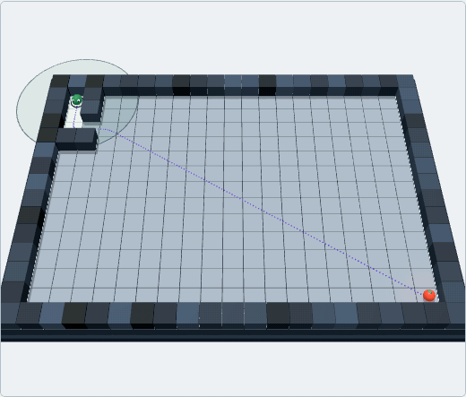
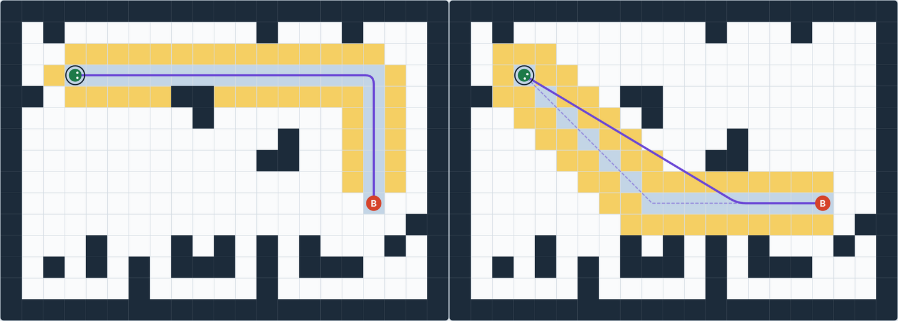
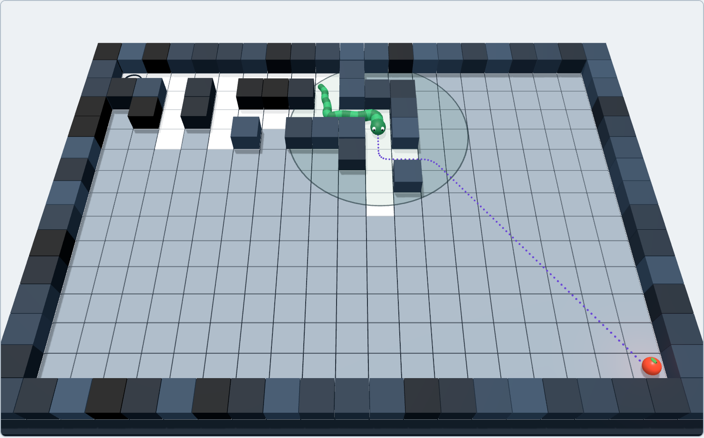

What happens when you drop a snake in a maze it can't see, and tell it to find the way out?

It does what you or I would do. It heads toward the goal, walks into a dead end, realizes it was wrong, backs out and tries another way. Along the way it draws a map of what it has learned, and each wrong turn makes its next guess a little smarter.

That's the project I built. Here is one run of it:

*One run of the snake exploring a hidden maze. The dotted line is its current plan, and it changes every time the snake finds a wall.*

The idea behind it is something you use every day.

## The idea behind your GPS

When your phone plans a route home, it doesn't try every possible road. It would take forever. It uses a smart shortcut: always explore the option that looks most promising, meaning the one that has cost you little so far and still looks close to your destination.

That idea is an algorithm called **A\*** (say "A-star"), one of the most famous in computer science. Navigation apps use it to plan routes, video games use it so characters can walk around obstacles, and robots use it to move through rooms.

My mentor suggested I build something with it to see how it works in real life. So I made a snake and a maze, with Claude as a companion.

## How A\* decides: g, h and f

For every cell in the maze, A\* keeps three numbers:

| Number | What it means |
|---|---|
| **g** | The real cost of getting from the start to this cell. It's known exactly, because we already walked it. |
| **h** | A *guess* of the cost left to reach the goal. It ignores walls and just counts grid steps. |
| **f = g + h** | The predicted cost of the whole trip if it goes through this cell. |

*The search in action. Each cell shows g (top left), h (top right) and f = g + h (middle). Blue cells are already worked on, and yellow cells are waiting their turn. Along the winning route, f stays at 24 the whole way, because the guess turned out to be exactly right.*

The rule is simple: **always work on the waiting cell with the lowest f.** When the cell it picks is the goal, the search is over, and A\* follows its "came from" links back to the start. That's the best path.

One rule makes it trustworthy: the guess h may be too low, but never too high. That's what guarantees the path A\* returns is truly the shortest. (If the guess is deliberately too high, the search gets faster but the path can get longer, and I included a setting in the demo to show that.)

Every cell is in one of three states: **unseen**, **open** (discovered and waiting its turn) or **closed** (already worked on). Each round, A\* takes the open cell with the lowest f, closes it, and looks at its neighbors. If it finds a cheaper way to a neighbor, it updates that neighbor's numbers. This repeats until the goal is picked.

## How the project is structured

I kept the project in small files, each with one job. The most important rule I followed was to keep the thinking separate from the looks.

| Part | Its job |
|---|---|
| **The search** (`astar.js`) | The A\* algorithm itself. It only takes a maze and returns a path. It has no idea a snake or a screen exists. |
| **The waiting list** (`heap.js`) | A\* needs the lowest-f cell fast, every time. A *min-heap*, a tree stored in a list, keeps it on top, so picking it takes a few steps instead of scanning everything. |
| **The maze** (`maze.js`) | Builds a random maze, then removes a few walls so there are loops and A\* has real choices to compare. |
| **The route shaper** (`path.js`) | Turns A\*'s staircase of grid cells into a smooth curve the snake can glide along. |
| **The game** (`game.js`) | Holds the rules and the state. It works like a small machine that moves through phases (searching, moving, arrived) and does one small step at a time. |
| **The settings** (`config.js`) | Constants that never change while it runs, like maze size, speed and vision range. |
| **The drawing** (`render.js`, `render3d.js`) | Draw the game in 2D and in 3D. They only read the game's state and never change it. |
| **The controller** (`main.js`) | Handles the buttons and runs the animation loop that keeps everything moving. |

The flow is one-way: the controller asks the game to take a step, the game uses the search, and the search uses the waiting list. Then the drawing code paints whatever state the game is in. Because the search doesn't know about the screen, I could change how everything looks, or how the snake moves, without ever touching the algorithm.

## Making it feel alive

My first version was a robot, with straight lines and sharp corners, only up, down, left and right. So I upgraded it:

- **Natural movement:** the snake moves diagonally, cuts across open floor, and glides around corners like a real snake. A diagonal step costs a bit more than a straight one (about 1.41), and the guess h was adjusted to match.
- **Fog of war:** in my favorite mode, the maze is hidden and the snake only sees a few cells around it. It makes a plan assuming the unseen parts are open, then makes a new plan every time it discovers a wall. Because it assumes the best case, its first plan is too optimistic, and every wall it finds can only make the route longer, so its estimate rises toward the real cost as it learns. Robots use the same idea to explore places nobody has mapped.
- **3D view:** you can watch from above, or from a camera that follows the snake.

*The same room, two snakes. Left: 4 directions, so the route is made of right angles. Right: 8 directions plus smoothing, so it cuts across open floor. The dashed line is what A\* found on the grid, and the solid line is the route the snake follows.*

*Explore mode in 3D. Unseen ground is grey, and the circle is how far the snake can see. The dotted line is its current plan, which assumes the unseen cells are open.*

In my tests on hundreds of random mazes, the snake that couldn't see the maze travelled only about 13% farther than one that knew the whole thing. A\* also looked at far fewer cells than a plain search without the guess, which is the whole point of h.

## What I took from it

- **Hard-sounding ideas are often simple underneath.** A\* is one formula and one habit: always try the most promising option first.
- **Explaining something back is the fastest way to learn it.** My mistakes only showed up once I tried to say it simply.
- **Keep the thinking separate from the looks.** That one choice let me add smooth movement, a hidden maze and a 3D view without rewriting the algorithm.
- **Make it something you can see.** Watching the search spread cell by cell taught me more than reading about it.

Even though it's just a simple project, a simple algorithm and a bit of code, it describes real life in a lot of ways. We know our starting point, and we know our goal, B. But like the snake, we never know the exact path to get there: which way we can go, which wall we'll run into. It might be a fast path, it might be a long one. What matters in the end is that we reach B.

If you'd like to talk about the project, or about what I want to build next, I'd love to hear from you.
